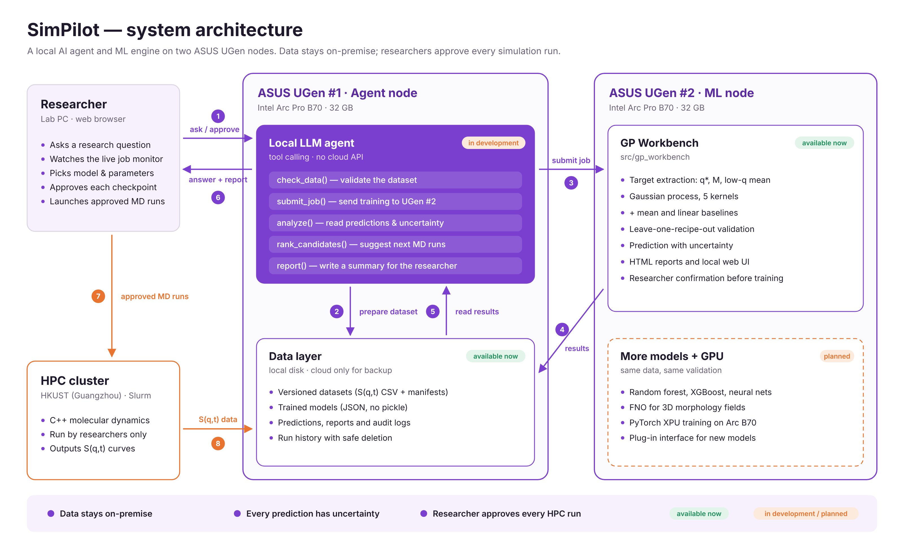

# SimPilot

**A local AI research platform where machine learning and AI agents work together.**

ASUS UGen AI League 2026 · Battlefield Thunderstorm · Workplace AI · Stage I
Team **LLM說什麼都隊** · National Tsing Hua University

SimPilot helps research teams decide which experiment or simulation to run next. A machine learning engine learns from the small datasets that labs already have and attaches an uncertainty to every prediction. A local LLM agent turns a research question into tool calls: it checks the data, submits training jobs, reads the results, writes a report and suggests the most valuable next run. Researchers watch every step and approve each checkpoint. Everything runs on two ASUS UGen workstations, so data and models never leave the lab.



*Figure 1. SimPilot architecture. Green tags mark components available in this repository; orange tags mark components in development or planned.*

## Key features

- **ML with uncertainty.** Gaussian process models (5 kernels) with mean and linear baselines; every prediction comes with an interval, not just a number.
- **Local AI agent.** An LLM with tool calling runs on its own GPU node and coordinates data checks, training, analysis and reporting. No cloud API is needed.
- **Researchers stay in control.** A live job monitor shows each step, and automation pauses at checkpoints until a researcher approves. The agent never launches simulations by itself.
- **Any ML model.** Researchers choose the model and its parameters, or let them auto-tune. All models share the same data and validation, so they can be compared fairly.
- **Data stays on-premise.** Datasets, models, predictions and audit logs are stored locally.

## Hardware

| Node | Hardware | Role |
|---|---|---|
| ASUS UGen #1 · Agent node | Intel Arc Pro B70, 32 GB | Local LLM agent and data layer |
| ASUS UGen #2 · ML node | Intel Arc Pro B70, 32 GB | Model training, validation and prediction |

Two nodes keep the agent responsive while models train, and both workloads fit in 32 GB with headroom.

## Implementation status

| Component | Status | Location |
|---|---|---|
| GP Workbench: target extraction, 5 GP kernels + baselines, leave-one-out validation, uncertainty diagnostics, HTML reports, local web UI | ✅ Available | [`gp-workbench/`](gp-workbench/) |
| Recorded five-recipe benchmark and model card | ✅ Available | [`gp-workbench/BENCHMARK.md`](gp-workbench/BENCHMARK.md), [`MODEL_CARD.md`](gp-workbench/MODEL_CARD.md) |
| Local LLM agent with tool calling | 🚧 In development | `src/` (Stage II) |
| Live job monitor with approval checkpoints | 🚧 In development | Stage II |
| More models: random forest, XGBoost, neural networks, plug-ins | 🚧 Planned | Stage II |
| Fourier Neural Operator (FNO) for 3D morphology fields | 🚧 Planned | Stage II |
| GPU training on Intel Arc Pro B70 and two-node deployment | 🚧 Planned | Stage II |

## Quick start (GP Workbench)

Requires Python 3.13 (64-bit). On Windows:

```powershell
git clone <this repository>
cd SimPilot\gp-workbench
py -3.13 -m venv .venv
.\.venv\Scripts\python.exe -m pip install --only-binary=:all: -r requirements.txt
.\.venv\Scripts\python.exe -X utf8 local_app.py
```

The browser opens at `http://127.0.0.1:8765`. Click **載入五配方範例** (Load five-recipe example) and follow the steps in [`gp-workbench/README.md`](gp-workbench/README.md). No Google account, API key or raw simulation data is needed.

To reproduce the analysis without a browser:

```sh
cd gp-workbench
python run_example.py --out runtime --target low_q_shell_mean --kernels linear rbf matern_32
```

## First use case: polymer simulation (APCN)

Our first application is **amphiphilic polymer co-networks (APCNs)**: polymer networks that join hydrophilic and hydrophobic chains with covalent crosslinks and form nanoscale phase-separated structures. These structures control swelling, mechanical, optical and transport properties, but studying them requires C++ molecular dynamics (MD) simulations on HPC. Each new recipe waits in the HPC queue and runs for about 48 hours.

SimPilot applies a *predict first, simulate only where the model is unsure* loop:

1. A researcher asks a question, such as the expected structure at a new composition.
2. The agent checks the data and calls the ML engine.
3. The model predicts structural targets from S(q,t) scattering curves (characteristic wavevector q\*, composition-fluctuation strength M, low-q mean), with uncertainty.
4. The agent ranks candidate recipes by how much a new simulation would teach the model.
5. The researcher approves which MD runs to launch, and the new results improve the next prediction.

**Recorded results (five recipes, one seed each, leave-one-recipe-out):** the RBF-kernel GP reached a mean absolute error of 0.023 on the three interior recipes, compared with 0.97 for a linear baseline, with all held-out points inside the 90% interval. These are exploratory results on five observations; see [`BENCHMARK.md`](gp-workbench/BENCHMARK.md) for the full tables and limits.

**Stage II targets:** prediction error within 10% of MD on unseen recipes, and 20% fewer simulation runs at the same error. These are goals, not measured results.

## Repository structure

```
SimPilot/
├── README.md              this overview
├── requirements.txt       points to gp-workbench/requirements.txt
├── docs/                  architecture figure, references, meeting notes
├── gp-workbench/          GP Workbench (available now)
├── src/                   AI agent and integration code (Stage II)
├── notebooks/             data exploration and experiments (Stage II)
└── tests/                 integration tests (Stage II); workbench tests are in gp-workbench/tests
```

The C++ MD simulation code and raw simulation data are not part of this repository.

## Roadmap

- [x] GP Workbench with target extraction, model comparison and uncertainty diagnostics
- [x] Five-recipe benchmark, model card and release checks
- [ ] Local LLM agent with tool calling on ASUS UGen #1
- [ ] Live job monitor and approval checkpoints
- [ ] More ML models and GPU training on Intel Arc Pro B70
- [ ] FNO proof of concept for morphology fields
- [ ] End-to-end measurement: prediction error, run savings, memory and speed

## Team

| Name | Role |
|---|---|
| 吳柏勳 | Leader |
| 黃彥融 | Member |
| 黃靖翔 | Member |
| 洪稚翔 | Member |
| 陳昱軒 | Member |

Advisor: Prof. Chieh-Szu Huang (黃捷思), Functional Hybrid Materials Research Group, National Tsing Hua University.
HPC simulation support: HKUST (Guangzhou).

## References

See [`docs/references.md`](docs/references.md).

## License

No open-source license has been chosen yet. See [`gp-workbench/LICENSING.md`](gp-workbench/LICENSING.md).
