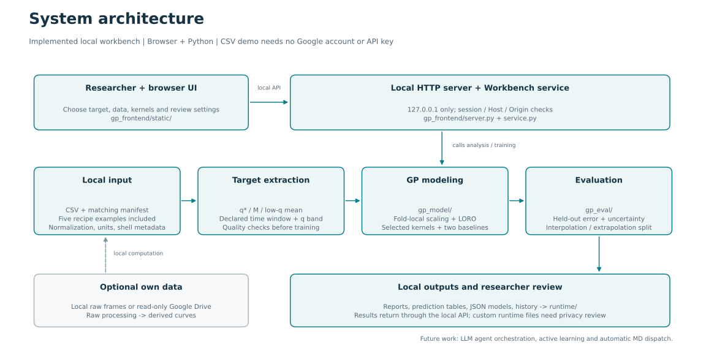
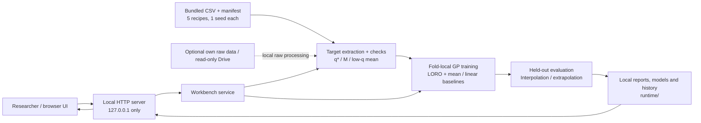

# System architecture

The shipped application is a local GP research workbench. Its Python computation engine and browser interface are implemented. It does not currently contain an LLM agent, autonomous active learning or an MD scheduler. These are future integration work.

## Execution and data flow

The browser sends a declared project to the loopback HTTP server. `Workbench` schedules target extraction and training locally. The bundled CSV workflow needs neither network access after installation nor access to the original research computer or Google Drive.

A target check verifies the CSV/manifest definition, units, time window and target-specific requirements. A passed check means the label can be extracted under those rules, not that equilibrium or material identity has been established. Training holds out one entire recipe ratio at a time and fits preprocessing only on the other recipes. Evaluation separates interior interpolation from endpoint extrapolation. Full-data fitted curves are separate from held-out scores.

| Layer | Main files | Responsibility |
|---|---|---|
| Browser interface | `gp_frontend/static/index.html`, `app.js`, `targets.js` | Target/source and kernel selection, inspection, review and results |
| Local HTTP boundary | `gp_frontend/server.py` | Loopback bind, session/API checks, Host/Origin checks and guarded reports |
| Workbench orchestration | `gp_frontend/service.py` | Background jobs, project settings, target checks, training and local outputs |
| Examples / optional sources | `examples/`, `gp_frontend/examples.py`, `raw.py`, `drive.py`, `drive_auth.py` | Five CSVs; optional local raw processing and own read-only Drive |
| Target extraction | `gp_frontend/quality.py`, `m_quality.py`, `low_q_quality.py`; `gp_eval/targets/` | Independent q*, M and low-q definitions and diagnostics |
| Model engine | `gp_model/workflow.py`, `models.py`, `kernels.py`, `tasks.py` | Folds, scaling, GP/baseline fits, JSON artifacts, condition/early CLI contracts |
| Evaluation | `gp_eval/core.py`, `report.py`, `report_template.html` | Error and Gaussian scores, interval diagnostics, scope tables and HTML |
| Local storage | `runtime/` | Generated reviews, runs, models, reports and optional caches; ignored by Git |

## Boundaries and optional features

The browser and HTTP service run on the same machine. Only `127.0.0.1` is supported; this is not a hosted multi-user service. The server can access files intentionally selected by its user and is not a general-purpose sandbox.

Raw and Drive sources are optional. Drive uses the operator's own explicit read-only OAuth authorization. No organizer needs it for the CSV example. No credentials, raw coordinates or private runtime folders are distributed.

The GUI uses ratio as its model input. Saved condition models can be queried at new ratios through the CLI. Early-observation workflows have separate feature/time contracts. Stage-1-to-stage-3 prediction has not been established.

## Editable diagram source

The static SVG above renders directly in the README. Its editable flowchart source is [docs/architecture.mmd](docs/architecture.mmd). GitHub can also render this Mermaid description.

See [FEATURES.md](FEATURES.md) for the full implemented/optional/planned inventory and [SECURITY.md](SECURITY.md) for the local trust model.
