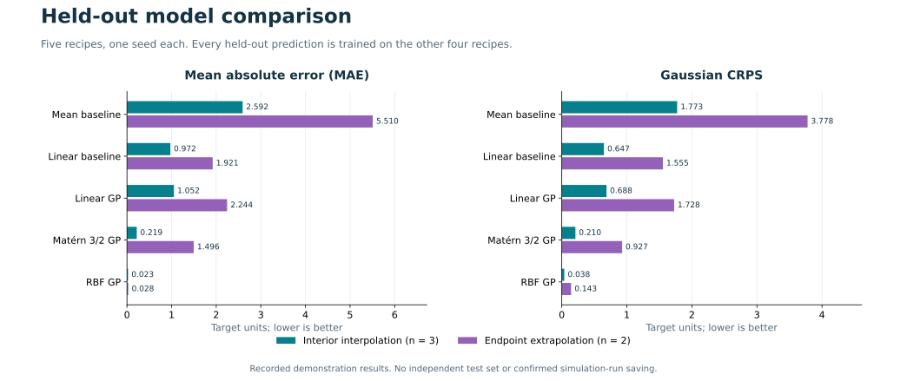
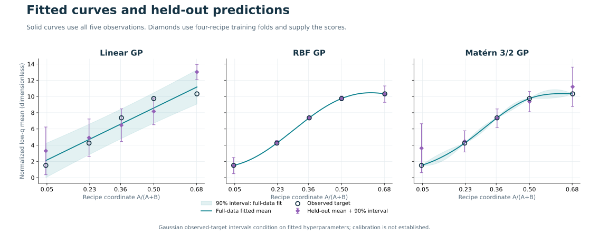

# Recorded five-recipe benchmark

These are **recorded numerical results**, not estimated targets. They come from the existing Windows isolated-environment release validation run on 2026-10-27. This documentation supplement, packaged on 2026-10-28, reuses those results without retraining or rerunning application tests.

The recorded scientific implementation hashes match the shipped model-engine files. Public outputs were reconstructed from explicit scientific-field allowlists rather than copying private HTML reports or runtime folders. [metadata.json](benchmarks/five_recipe_low_q/metadata.json) records provenance, data fingerprints and runtime versions.



## Fixed experiment

- Five real derived S(q,t) CSVs, one seed per recipe: 1:21, 5:17, 8:14, 11:11 and 15:7.
- Input: declared recipe coordinate A/(A+B), range 0.0454545455-0.6818181818.
- Target: dimensionless normalized low-q mean. Time-average frames 1490-1499, then equally average the five complete exact nonzero shells in `(0,0.11]` inverse simulation length. No subtraction of 1.
- Two temporal blocks are diagnostics, not extra training samples.
- Three GPs (Linear, RBF, Matern 3/2) and two baselines share five leave-one-ratio-out folds: four training rows and one held-out row each.
- Hyperparameters and X/y scaling are fitted on training rows only. Selection is exploratory; no independent selection dataset or nested validation is supplied.

## Interior interpolation: 3 held-out recipes

Held-out labels: 5:17, 8:14 and 11:11. Each lies within the range of the other four training recipes.

| Model | MAE | RMSE | CRPS | 90% coverage | Mean 90% width |
|---|---:|---:|---:|---:|---:|
| Mean baseline | 2.592382 | 2.875772 | 1.773112 | 100% | 14.873500 |
| Linear baseline | 0.972167 | 1.055248 | 0.647428 | 100% | 4.004639 |
| Linear GP | 1.051936 | 1.122032 | 0.687890 | 100% | 3.979395 |
| Matérn 3/2 GP | 0.219108 | 0.257705 | 0.209505 | 100% | 2.470017 |
| RBF GP | 0.023081 | 0.026528 | 0.038285 | 100% | 0.513740 |

## Endpoint extrapolation: 2 held-out recipes

Held-out labels: 1:21 and 15:7. Each lies outside the range of the other four training recipes. This is an endpoint leave-out diagnostic, not validation of arbitrary distant extrapolation.

| Model | MAE | RMSE | CRPS | 90% coverage | Mean 90% width |
|---|---:|---:|---:|---:|---:|
| Mean baseline | 5.509581 | 5.583703 | 3.778237 | 50% | 11.692147 |
| Linear baseline | 1.921210 | 2.089785 | 1.554722 | 50% | 4.006300 |
| Linear GP | 2.243839 | 2.289125 | 1.727675 | 50% | 3.877524 |
| Matérn 3/2 GP | 1.495598 | 1.620765 | 0.927389 | 100% | 5.442881 |
| RBF GP | 0.028251 | 0.028371 | 0.143108 | 100% | 2.007116 |

## Supplementary summary: all 5 held-out recipes

This summary mixes interpolation and endpoint extrapolation and must not replace the separate tables.

| Model | MAE | RMSE | CRPS | 90% coverage | Mean 90% width |
|---|---:|---:|---:|---:|---:|
| Mean baseline | 3.759262 | 4.175300 | 2.575162 | 80% | 13.600959 |
| Linear baseline | 1.351785 | 1.554030 | 1.010345 | 80% | 4.005304 |
| Linear GP | 1.528697 | 1.688612 | 1.103804 | 80% | 3.938646 |
| Matérn 3/2 GP | 0.729704 | 1.044317 | 0.496658 | 100% | 3.659163 |
| RBF GP | 0.025149 | 0.027280 | 0.080214 | 100% | 1.111090 |

RBF has the lowest recorded MAE and CRPS among these candidates on these five observations. This does not establish a universal winner, cross-seed reliability or performance on another dataset. Coverage is a count: interpolation changes in increments of 1/3 and endpoint coverage in increments of 1/2.

## Predictions and fitted curves



Solid curves and shaded 90% intervals use **all five observations** and are not used for held-out scoring. Diamonds and error bars are the leave-one-ratio-out predictions that supply the scores.

Intervals are Gaussian plug-in intervals for a new observed target, conditional on optimized hyperparameters. They include fitted observation noise, not integrated hyperparameter uncertainty. The Gaussian model can assign mass below the physical nonnegative target domain; that diagnostic is retained. A 100% coverage count here does not establish calibration.

## Files and interpretation

| File | Contents |
|---|---|
| [training_data.csv](benchmarks/five_recipe_low_q/training_data.csv) | Five extracted targets and recipe coordinates |
| [held_out_predictions.csv](benchmarks/five_recipe_low_q/held_out_predictions.csv) | 25 rows: five models x five folds; truths, means, errors, scores and intervals |
| [metrics_by_scope.csv](benchmarks/five_recipe_low_q/metrics_by_scope.csv) | 15 rows: five models x three scope summaries; full-precision metrics |
| [regression_curves.csv](benchmarks/five_recipe_low_q/regression_curves.csv) | Full-data curves/90% intervals; illustration only |
| [uncertainty_components.csv](benchmarks/five_recipe_low_q/uncertainty_components.csv) | Held-out observed-target, latent and noise standard deviations |
| [fit_details.json](benchmarks/five_recipe_low_q/fit_details.json) | Model/optimizer specifications, folds, fitted/scaling parameters and original warnings |
| [metadata.json](benchmarks/five_recipe_low_q/metadata.json) | Run date, software versions, data/code hashes, extraction and privacy scope |

`error = pred_mean - y_true`; positive bias means overprediction. `z = (y_true - pred_mean)/pred_std`. MAE, RMSE and Gaussian CRPS use target units; lower is better. NLPD is Gaussian negative log predictive density. Coverage is a fraction in CSVs; width is the full interval width. Recipes are equally weighted within each scope, equivalent to equal observation weighting here because each has one seed. Scores use the original target scale.

The original run recorded **12 noise lower-bound warnings**: RBF and Matern 3/2 in each of five folds plus both full-data fits. Warnings are retained in `fit_details.json`; bounds were not retuned. Tiny optimized noise must not be interpreted as measured reproducibility across independent simulations.

No acceptable-error threshold or confirmatory winner rule was configured. These files do not validate equilibrium, morphology, material identity, cross-seed/stage performance, MD run saving, agent response time, GPU throughput or experimental agreement. The proposed 20% run saving remains a future objective.

## Reproduce from public data

After installing the pinned environment in [README.md](README.md):

```sh
python run_example.py --out runtime --target low_q_shell_mean --kernels linear rbf matern_32
```

This creates a new local run. Compare its `training_data.csv` and `condition/evaluation/metrics_by_scope.csv` with these files; regenerated timestamps/identifiers and tiny optimizer differences need not be byte-identical. Reference runtime: Python 3.13.9, NumPy 2.3.5, SciPy 1.16.3, scikit-learn 1.7.2. Other platforms have not been validated.

No retraining was performed solely for these documents and figures. Original private reports, complete training audits and loadable trained-model artifacts are not shipped.
